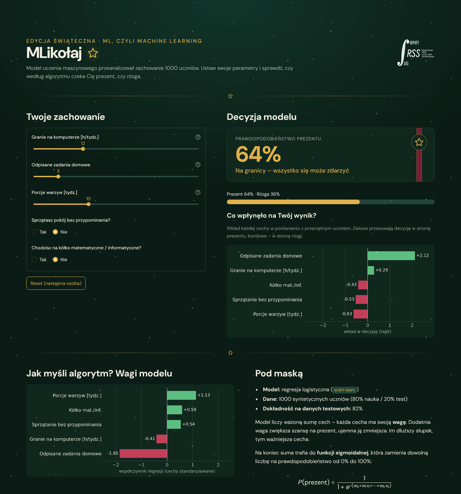

# MLikołaj

**ML** to skrót od *machine learning*, czyli uczenie maszynowe. MLikołaj to Mikołaj,
który o prezentach decyduje za pomocą uczenia maszynowego.

Interaktywna aplikacja pokazująca uczniom szkół podstawowych i średnich, jak działa
uczenie maszynowe. Uczeń ustawia suwakami swoje „zachowanie”, a model na bieżąco
szacuje, czy czeka go **prezent**, czy **rózga**, i pokazuje, które cechy zdecydowały
o wyniku.

Aplikacja powstała na stoisko wydziałowe. Używa Streamlita i scikit-learn.

**Autor:** Rada Samorządu Studenckiego WMFI UG



## Spis treści

- [Funkcje](#funkcje)
- [Szybki start](#szybki-start)
- [Jak to działa](#jak-to-działa)
- [Jak czytać wykresy](#jak-czytać-wykresy)
- [Struktura repozytorium](#struktura-repozytorium)
- [Dostosowanie](#dostosowanie)
- [Wskazówki na stoisko](#wskazówki-na-stoisko)

## Funkcje

- **Wynik na żywo:** po każdej zmianie suwaka lub przycisku aplikacja przelicza
  prawdopodobieństwo prezentu i pokazuje je w procentach oraz na pasku postępu.
- **Pięć cech wejściowych:**

  | Cecha | Kontrolka | Zakres |
  |---|---|---|
  | Granie na komputerze (h/tydzień) | suwak | 0–40 |
  | Odpisane zadania domowe | suwak | 0–20 |
  | Porcje warzyw (tydzień) | suwak | 0–30 |
  | Sprzątanie pokoju bez przypominania | Tak/Nie | – |
  | Kółko matematyczne/informatyczne | Tak/Nie | – |

- **Wyjaśnienie decyzji:** wykres wkładu każdej cechy w wynik konkretnej osoby
  oraz wykres globalnych wag modelu.
- **Sekcja „Pod maską”:** typ modelu, dokładność na danych testowych, wzór funkcji
  sigmoidalnej i podgląd danych treningowych.
- **Logo autora:** małe logo Rady Samorządu Studenckiego WMFI UG w nagłówku (na wąskich
  ekranach ukryte) i w stopce z podpisem autora.
- **Przycisk „Reset (następna osoba)”:** przywraca ustawienia domyślne dla kolejnego gościa.
- **Świąteczny wygląd:** ciemna zieleń świerku, bordo i złoto, font DM Sans,
  delikatnie padający śnieg (czysty CSS), złote gwiazdki jako separatory sekcji
  i karta wyniku przewiązana wstążką jak paczka. Ikona na karcie zmienia się
  zależnie od wyniku: prezent, gwiazdka albo rózga.

## Szybki start

Wymagany Python 3.10 lub nowszy (zalecany 3.11+, bo tego wymagają najnowsze wersje Streamlita i scikit-learn).

```bash
git clone https://github.com/mfiugsamorzad/mfikolajki-model.git
```

```bash
cd mfikolajki-model
```

```bash
pip install -r requirements.txt
```

```bash
streamlit run app.py
```

Aplikacja otworzy się w przeglądarce pod adresem `http://localhost:8501`.

Na stoisku warto uruchomić ją w trybie bez automatycznego otwierania przeglądarki i
otworzyć adres ręcznie w trybie pełnoekranowym (F11):

```bash
streamlit run app.py --server.headless true
```

## Jak to działa

### 1. Dane syntetyczne

Przy starcie aplikacja generuje 1000 zmyślonych uczniów (ziarno losowości `42`, więc
dane są zawsze takie same). Cechy są losowane w zakresach suwaków. Etykietę
(1 = prezent, 0 = rózga) losujemy według ukrytej reguły:

```
logit = 1.0 − 0.05·granie − 0.30·odpisane + 0.12·warzywa + 1.0·sprzątanie + 1.4·kółko
P(prezent) = 1 / (1 + e^(−logit))
```

Etykieta jest losowana z tym prawdopodobieństwem, więc dane zawierają realistyczny „szum”.
Nawet grzeczny uczeń może czasem dostać rózgę.

### 2. Model

- `StandardScaler` sprowadza cechy do wspólnej skali, dzięki czemu wagi można ze sobą porównywać.
- `LogisticRegression` uczy się wag na 80% danych.
- Pozostałe 20% służy do sprawdzenia dokładności (około 82%).

Model **nie zna** ukrytej reguły. Odkrywa ją sam na podstawie przykładów. To dobry punkt
wyjścia do rozmowy: wagi wyuczone przez model są zbliżone do tych w regule, choć nie identyczne.

Dane i model są liczone tylko raz (`st.cache_data` / `st.cache_resource`), więc
kolejne zmiany suwaków działają natychmiast.

### 3. Werdykt

| Prawdopodobieństwo prezentu | Werdykt | Kolor |
|---|---|---|
| 65% i więcej | Prezent prawie pewny | zielony |
| 40–64% | Na granicy | złoty |
| poniżej 40% | Rośnie ryzyko rózgi | bordowy |

## Jak czytać wykresy

- **„Co wpłynęło na Twój wynik?”:** wkład każdej cechy w decyzję dla aktualnych
  ustawień, **w porównaniu z przeciętnym uczniem** ze zbioru danych.
  - Zielony słupek przesuwa decyzję w stronę prezentu, bordowy w stronę rózgi.
  - Przykład: mała liczba odpisanych zadań daje zielony słupek, bo to mniej niż średnia.
- **„Jak myśli algorytm? Wagi modelu”:** współczynniki regresji dla cech
  standaryzowanych. Mówią, jak model ocenia każdą cechę niezależnie od użytkownika.
  - Znak wagi: dodatni zwiększa szansę na prezent, ujemny ją zmniejsza.
  - Długość słupka: im dłuższy, tym ważniejsza cecha.

## Struktura repozytorium

```
.
├── app.py                  # cała aplikacja: dane, model, interfejs, wykresy
├── requirements.txt        # zależności Pythona
├── assets/
│   └── logo_rss.png        # białe logo RSS WMFI UG na przezroczystym tle
├── .streamlit/
│   └── config.toml         # ciemny, świąteczny motyw bazowy i kolor akcentu
└── docs/
    └── zrzut-ekranu.png    # zrzut ekranu do README
```

## Dostosowanie

Wszystko znajduje się w `app.py`:

| Co zmienić | Gdzie |
|---|---|
| Siła wpływu cech na wynik | współczynniki `logit` w funkcji `wygeneruj_dane` |
| Liczba rekordów, ziarno losowości | stałe `LICZBA_REKORDOW`, `ZIARNO` |
| Kolory | stałe `KOLOR_*` na początku pliku (pamiętaj też o `.streamlit/config.toml`) |
| Śnieg (gęstość, prędkość, widoczność) | reguły `.stApp::before` / `.stApp::after` w funkcji `wstrzyknij_css` |
| Ikony (gwiazdka, prezent, rózga) | stałe `IKONA_*` (SVG) |
| Autor i logo | stałe `AUTOR` i `SCIEZKA_LOGO` (bez pliku logo aplikacja działa, tylko go nie pokazuje) |
| Progi werdyktów | blok `if p_prezent >= 0.65` w funkcji `main` |
| Wartości startowe suwaków | słownik `DOMYSLNE` |
| Nazwy cech w interfejsie | słownik `CECHY` |

## Wskazówki na stoisku

- **Najsilniejsza cecha to odpisane zadania.** Przesunięcie tego suwaka mocno zmienia
  wynik, co dobrze pokazuje, czym jest waga cechy.
- **Proponowane pytanie dla licealistów:** „Dlaczego przy małej liczbie odpisanych
  zadań słupek jest zielony?” Prowadzi to do rozmowy o porównaniu ze średnią i o standaryzacji.
- **Pytanie o dane i uprzedzenia modelu:** „Skąd model wie, że warzywa są dobre?”
  Odpowiedź: z danych, które mu daliśmy. Model jest tak dobry (i tak stronniczy),
  jak dane, na których się uczył.
- **Animacja śniegu:** jeśli w systemie włączone jest ograniczenie animacji
  („reduce motion”), śnieg zostaje nieruchomy.
- **Internet:** font DM Sans pobiera się z Google Fonts. Bez dostępu do internetu aplikacja
  działa, ale przeglądarka użyje zwykłej czcionki bezszeryfowej.
